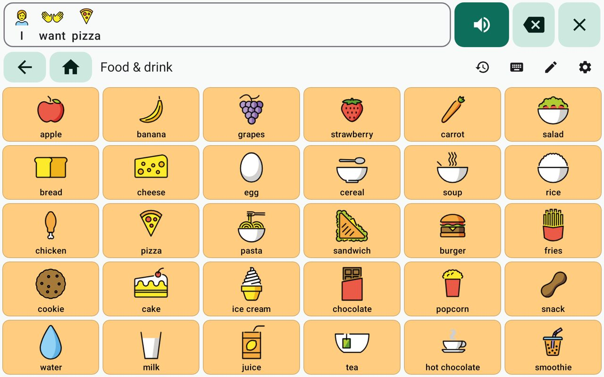
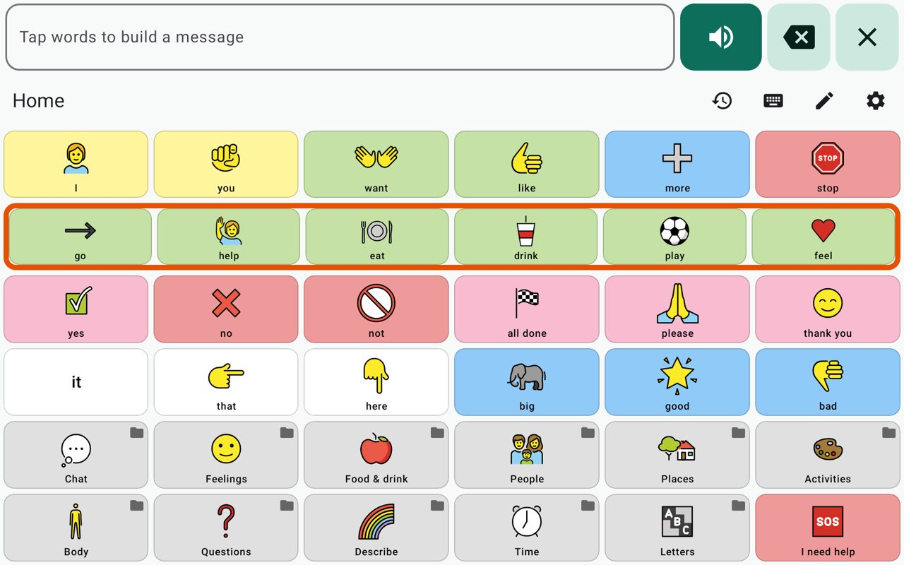
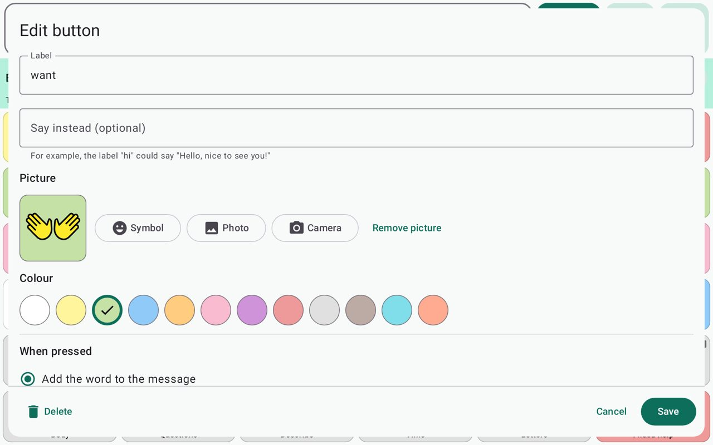
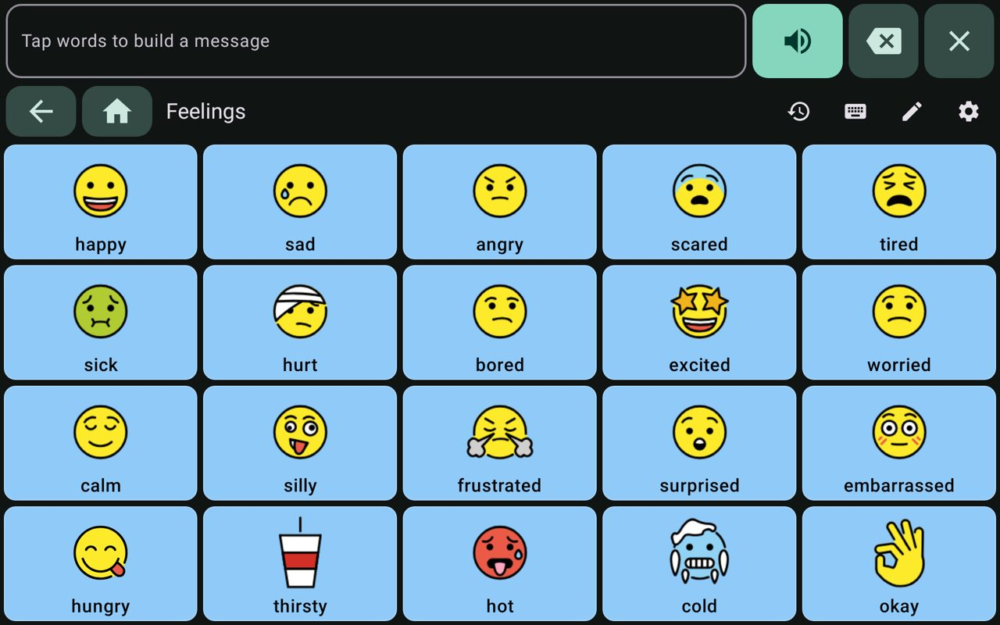
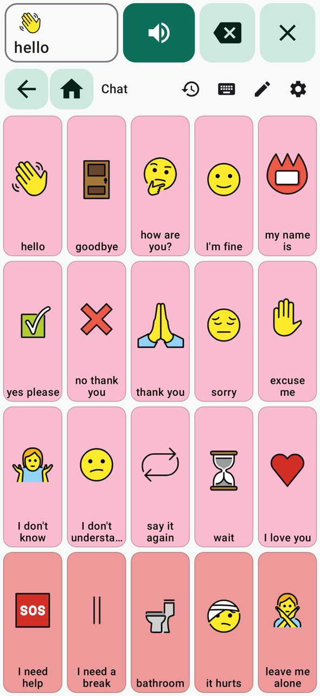

<h1 align="center">Saywell</h1>

<p align="center">
  <strong>A free, offline AAC talker for Android phones and tablets.</strong><br>
  Tap symbols to build a sentence and Saywell says it out loud with a natural voice that runs on the device.<br>
  No internet, no account, no subscription. It also works with one or two switches.
</p>

<p align="center">
  <a href="https://github.com/lobojoel2003/Saywell/actions/workflows/ci.yml"></a>
  <a href="https://github.com/lobojoel2003/Saywell/releases/latest"></a>
  <a href="LICENSE"></a>
  
  
</p>

| Building a sentence | Switch scanning (row highlighted) | Editing a button |
|---|---|---|
|  |  |  |

| Dark theme | On a phone |
|---|---|
|  |  |

<sub>Rendered from the app by its own screenshot test (`ScreenshotTest`).</sub>

## Contents

- [Why Saywell](#why-saywell)
- [What it does](#what-it-does)
- [Install](#install)
- [Using Saywell](#using-saywell)
- [Switch access](#switch-access)
- [Voices](#voices)
- [Boards and the Open Board Format](#boards-and-the-open-board-format)
- [Privacy](#privacy)
- [Building from source](#building-from-source)
- [Project layout](#project-layout)
- [Versions and releases](#versions-and-releases)
- [Contributing](#contributing)
- [Licence and credits](#licence-and-credits)

## Why Saywell

Augmentative and alternative communication (AAC) apps let people who can't rely on speech talk by
tapping symbols. Families who own Android phones or low-cost tablets are largely left out:

- **Proloquo2Go** costs $299.99, has no free trial and runs only on Apple devices
  ([IntuitionLabs listing](https://intuitionlabs.ai/software/speech-language-pathology/aac-augmentativealternative-communication/proloquo2go)).
- The free alternatives listed on [AlternativeTo](https://alternativeto.net/software/proloquo2go/)
  are almost all closed source and iPhone-only.
- [Cboard](https://github.com/cboard-org/cboard), the main open-source option, is a browser app that
  uses the browser's speech voice. Most of its 40+ languages were machine-translated and never reviewed.

Saywell is a native Android app built for that gap:

| Need | Saywell |
|---|---|
| Works with no internet | Everything runs on the device, including the voice. |
| A voice that sounds human | A neural [Piper](https://github.com/rhasspy/piper) voice is built in, run by [Sherpa-ONNX](https://github.com/k2-fsa/sherpa-onnx). The phone's own voices work too. |
| People with limited movement | One- and two-switch scanning, hold-to-select and tremor filtering. |
| Moving boards between apps | Imports and exports the [Open Board Format](https://www.openboardformat.org/) (`.obf`, `.obz`). |
| Cheap devices | Android 7.0 and newer, small per-processor APKs, no Google services needed. |

## What it does

- **Talk with symbols.** A starter vocabulary of 12 linked boards with 231 words and phrases:
  a home board of high-frequency core words (*I, want, more, stop, help, go, like, not…*) plus
  boards for chat, feelings, food and drink, people, places, activities, the body, questions,
  describing, time, and a letter board for spelling.
- **Colour-coded words** using the modified Fitzgerald Key most AAC systems share (people yellow,
  actions green, describing words blue, things orange, social words pink, questions purple).
- **A message bar** that builds the sentence with its symbols. Tap it, or *Speak*, to say it.
  *Delete* removes the last word (or ending, or letter); *Clear* starts again.
- **Speak each word** as it is tapped, so the person hears what they chose.
- **Type to talk** with word prediction that learns the person's own words.
- **Recent sentences** to say again with one tap.
- **Make it theirs.** Edit any button: words, what it says, colour, a symbol from 2,456 bundled
  [OpenMoji](https://openmoji.org) symbols, a photo from the gallery or camera, open another board,
  or run an action (clear, delete, speak, home, back, spelling space, add an ending such as *-s*).
  Resize boards up to 12 × 12, move buttons, hide buttons until they're introduced, add and delete
  boards, choose the home board, and undo.
- **Switch scanning** with one switch (automatic) or two (step), rows-then-buttons or one at a time,
  adjustable speed, auditory scanning, and "tap anywhere" as a switch.
- **Touch accommodations:** hold to select (with a progress bar) and ignore repeated presses.
- **Readable for everyone:** text size, labels above, below or hidden, light, dark and high-contrast
  themes, TalkBack and Android Switch Access labels on every control.
- **Lock** editing and settings behind a long press so they aren't opened mid-conversation.
- **Keeps the screen on** while talking (can be turned off).
- **Back up and share** all boards as `.obz`, or one board as `.obf`.

## Install

1. Open the [latest release](https://github.com/lobojoel2003/Saywell/releases/latest) on the Android device.
2. Download **one** APK:

   | File | For | Size |
   |---|---|---|
   | `Saywell-<version>-arm64-v8a.apk` | Most phones and tablets from the last few years | about 100 MB |
   | `Saywell-<version>-armeabi-v7a.apk` | Older or low-cost 32-bit devices (many budget tablets) | about 90 MB |
   | `Saywell-<version>-x86_64.apk` | Chromebooks and emulators | about 105 MB |
   | `Saywell-<version>-universal.apk` | Any device, if you're not sure | about 160 MB |

   Most of the size is the built-in voice (about 60 MB) and the speech engine, which is what lets
   Saywell talk without internet.

3. Open the file and allow your browser or file manager to install apps when Android asks.

Saywell needs Android 7.0 or newer. The English voice is built in, so it works straight away
without internet. Each release lists the SHA-256 checksums of the APKs and the signing certificate.

## Using Saywell

**Talking.** Tap words to build a sentence in the message bar at the top, then tap the bar or
*Speak*. Grey buttons with a folder mark open another board; *Back* and *Home* appear on the
navigation row when you're on another board. *Type to talk* (keyboard icon) and *Recent
sentences* (clock icon) are on the same row.

**Editing.** Press and hold the pencil to start editing (the hold can be turned off in Settings ›
Safety). Then:

- tap a button to change it, or an empty space to add one;
- press and hold a button, then tap another space, to move it;
- use the bar at the top to undo, change the board's name and size, or open *All boards* to jump
  to any board or create a new one;
- tap *Done* when finished.

**Settings** (press and hold the gear) has the voice, talking, display, touch and switch options,
plus importing, backing up and resetting boards.

A guide for families, teachers and therapists is in [docs/getting-started.md](docs/getting-started.md).

## Switch access

Saywell works with switch interfaces that connect over Bluetooth or USB and act as a keyboard
(most do). Turn on **Settings › Switch scanning › Use switch scanning**, then choose:

- **One switch:** the highlight moves by itself; press to choose. Set the time on each step and
  how many rounds before scanning pauses.
- **Two switches:** one switch moves the highlight, the other chooses.

Scanning goes row by row and then along the chosen row (or one button at a time). The message bar
controls are the first row. *Choose switch* and *Move switch* learn which key your switch sends
(Space and Enter by default). *Say each highlighted item* speaks the highlighted word for people who
can't see the screen well, and *Tap anywhere to choose* turns the whole board into one big switch.

Saywell's buttons are also labelled for Android's own Switch Access and TalkBack. See
[docs/switch-access.md](docs/switch-access.md).

## Voices

| Voice | How it works | Offline |
|---|---|---|
| **Saywell voices** (default) | Neural [Piper](https://github.com/rhasspy/piper) voices run by [Sherpa-ONNX](https://github.com/k2-fsa/sherpa-onnx) and [ONNX Runtime](https://onnxruntime.ai) on the device. The US English voice Kristin, trained on public-domain recordings, is built in. | Always |
| **The phone's voice** | Android's text-to-speech engine (for example Speech Services by Google). Rate and pitch are adjustable. | When the engine's voice data is installed |

More Saywell voices (English US and UK, Spanish, German and Portuguese, female and male) can be
downloaded once in **Settings › Saywell voices**, or installed from a file copied from
a computer for devices that never go online. Each voice shows its licence (model card). If the
chosen voice can't speak, Saywell falls back to the other one so a press of *Speak* always makes a
sound. Details and licences: [docs/voices.md](docs/voices.md).

## Boards and the Open Board Format

Saywell reads and writes the [Open Board Format](https://www.openboardformat.org/docs) used by
other AAC apps:

- **Import** `.obf` (one board) or `.obz` (a package of linked boards with pictures) from
  Settings › Boards. Add them to your boards (a folder button is added to the home board) or
  replace your boards. Links between boards, colours, pictures, hidden buttons and actions such as
  `:clear`, `:speak`, `:home` and `+s` are kept.
- **Export** all boards as `.obz` (a full backup) or the current board as `.obf`.

Files from other apps are read leniently (numeric ids, missing grids, `rgba()` colours, pictures
embedded or online). Boards larger than 12 × 12 are fitted to 12 × 12. See
[docs/open-board-format.md](docs/open-board-format.md).

## Privacy

Saywell has no accounts, ads, analytics or tracking. Boards, pictures and recent sentences stay on
the device (and in Android's own backup if you use it). The internet permission is used only when
you choose to download a voice, or import a board whose pictures are online. See
[PRIVACY.md](PRIVACY.md).

## Building from source

You need JDK 17 or newer (21 recommended) and the Android SDK (Android Studio installs it).

```bash
git clone https://github.com/lobojoel2003/Saywell.git
```

```bash
cd Saywell && ./gradlew assembleDebug
```

The APKs are in `app/build/outputs/apk/debug/`. The first build downloads, and checks against
pinned SHA-256 checksums: the Sherpa-ONNX Android library, the built-in voice (about 60 MB) and the
OpenMoji symbols. For quicker builds while developing, leave the voice out:

```bash
./gradlew assembleDebug -Psaywell.bundleVoice=false
```

Tests and checks:

```bash
./gradlew :core:check :app:testDebugUnitTest :app:lintRelease
```

`core` tests run on any JVM; the app's tests (including UI flows) run on the JVM with Robolectric.

## Project layout

| Path | What |
|---|---|
| `core/` | Plain Kotlin: board model and editing, Open Board Format import/export, message bar rules, switch-scanning state machine, symbol search, word prediction, starter vocabulary |
| `app/` | The Android app: Jetpack Compose UI, speech engines, voice management, storage, switch input |
| `buildSrc/` | Build steps that turn checksummed downloads into app assets (symbols, built-in voice) |
| `app/src/main/assets/voices/catalog.json` | Downloadable voices |
| `scripts/` | Release helpers and the voice-link check |
| `docs/` | Guides for families, switch users, voices, board files, releasing and architecture |

More detail: [docs/architecture.md](docs/architecture.md).

## Versions and releases

Saywell follows [Semantic Versioning](https://semver.org). The version lives in
[`version.properties`](version.properties) and the Android build number (`versionCode`) is derived
from it, `MAJOR × 10000 + MINOR × 100 + PATCH`, so every release upgrades the one before. CI builds
also show their workflow run number and commit on the About screen.

Pushing a tag `vX.Y.Z` runs CI, builds signed APKs for each processor type, and publishes a GitHub
Release with notes from [CHANGELOG.md](CHANGELOG.md) and SHA-256 checksums. See
[docs/releasing.md](docs/releasing.md).

## Contributing

Bug reports, board files that don't import well, switch hardware reports and code are all welcome.
Translations are welcome **only from people who speak the language well**; machine translations
are not accepted, because a wrong word in an AAC app is worse than an English one. See
[CONTRIBUTING.md](CONTRIBUTING.md) and the [code of conduct](CODE_OF_CONDUCT.md). Security
problems: [SECURITY.md](SECURITY.md).

## Licence and credits

Saywell is free software under the [GNU General Public License v3.0 or later](LICENSE).

It builds on:

- **[OpenMoji](https://openmoji.org)** symbols – the open-source emoji and icon project.
  License: [CC BY-SA 4.0](https://creativecommons.org/licenses/by-sa/4.0/).
- **[Sherpa-ONNX](https://github.com/k2-fsa/sherpa-onnx)** (Apache 2.0) with
  **[ONNX Runtime](https://github.com/microsoft/onnxruntime)** (MIT) and
  **[eSpeak NG](https://github.com/espeak-ng/espeak-ng)** (GPL 3.0) for on-device speech.
- **[Piper](https://github.com/rhasspy/piper)** voices; each voice's licence is in its model card,
  shown in the app.
- Kotlin, Jetpack Compose, [Coil](https://coil-kt.github.io/coil/) and Apache Commons Compress (Apache 2.0).
